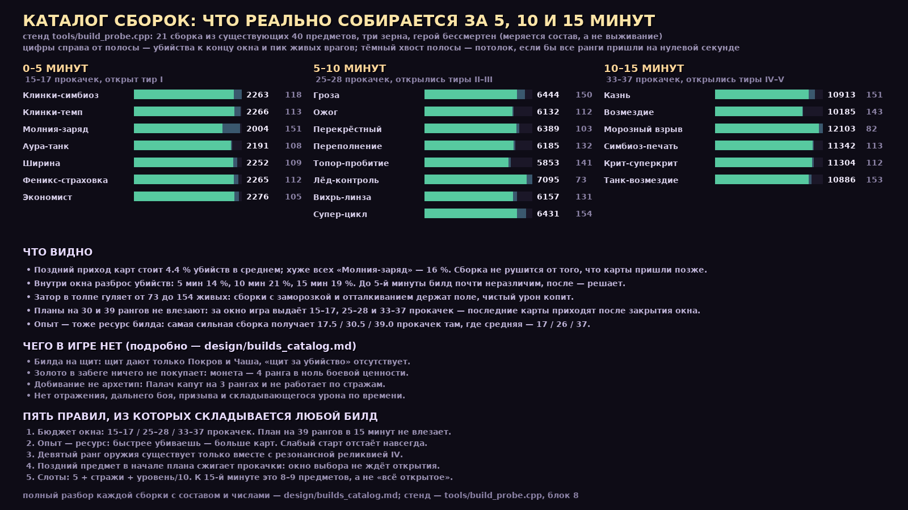

# Какие билды возможны — каталог сборок по окнам забега

2.10.45. Аудит оружия (2.10.42–44) отвечал на три вопроса: сколько наносит урона,
отличаются ли варианты друг от друга и есть ли у игрока стратегия. Остался четвёртый,
самый практичный: **какие сборки вообще можно собрать** — и что из них получается
к 5-й, 10-й и 15-й минуте забега.

Это не список пожеланий. Все двадцать один билд ниже собраны из существующих
сорока предметов и проверены стендом.



---

## Как считалось

Стенд `tools/build_probe.cpp`, блок 8 «Каталог билдов». Каждая сборка считается
по трём зёрнам, в штатном спавне игры, герой сам идёт к ближайшему самоцвету.

Одна и та же сборка считается дважды:

- **«сразу»** — сборка стоит с нулевой секунды. Это потолок: так выглядел бы билд,
  если бы игрок получил все карты мгновенно.
- **«честно»** — те же ранги выдаются по одному, только когда игра сама дала уровень
  и предмет уже открыт по времени. Это и есть реальная сборка.

Смертность в этом замере выключена намеренно: вопрос здесь про **состав**, а не про
«сколько прожил». Выживание замерено отдельно в 2.10.44 — и там стартовая сборка
живёт 13–19 секунд, поэтому смертный прогон мерил бы первые пятнадцать секунд
забега, а не силу билда.

Что стенд **не** воспроизводит: боссов (они отключены, а слоты растут по их
расписанию 90/180/270 с), сундуки и золото, рывок и кайтинг.

---

## Пять правил, из которых складывается любой билд

**1. Бюджет окна.** Забег выдаёт прокачки за уровни, а не за время. Замер по трём
зёрнам: **15–17** прокачек к 5-й минуте, **25–28** к 10-й, **33–37** к 15-й. Планы
на 39 рангов в 15-минутное окно не влезают — в каталоге такие планы честно
обрываются на 33–37.

**2. Опыт — тоже ресурс билда.** Самой сильной сборке стенд выдавал 17.5 / 30.5 / 39.0
прокачек там, где сборкам каталога достаётся 17 / 26 / 37. Разница — не в удаче:
сборка, которая быстрее убивает, быстрее собирает самоцветы и раньше получает
следующую карту. Слабый старт отстаёт по прокачкам, и это отставание не отыгрывается.

**3. Девятый ранг оружия существует только вместе с реликвией IV.** У оружия
потолок 8-го ранга, пока его резонансный артефакт не поднят до 4-го. Поэтому
«широкий» билд из двух оружий физически не может дотянуть ни одно из них до
вершины (это уже показано в 2.10.44, здесь только следствие для каталога).

**4. Порядок карт важнее, чем кажется.** Предмет, который откроется поздно, нельзя
ставить в план раньше ранних: прокачки, пришедшие до его открытия, сгорают — окно
выбора в игре не ждёт. Проверено на одном и том же наборе: пока «Угольный Фитиль»
(открывается на 8-й минуте) стоял третьим в плане, сборка «Ожог» успевала вложить
**16 рангов из 24 прокачек**; после перестановки поздних предметов в конец —
**26 рангов при 25 прокачках**. Десять вложений вернулись одной сортировкой:
сгоревшие прокачки — это не «слабый билд», а ошибка порядка карт.

**5. Слоты сборки.** `5 + убитые стражи + (уровень−1)/10`, максимум 20. К 15-й
минуте это 8–9 предметов без стражей и до 12 со стражами. Значит «широкий» билд —
это 6–8 предметов, а не «всё, что открылось»: двадцать билдов каталога держатся
в шести–восьми.

---

## Эпоха 1: 0–5 минут, 15–17 прокачек, открыт только тир I

К 5-й минуте доступно всё базовое (0–15) и с 3-й минуты — «Печать Пепельного
Сердца» (16). Поздние тиры ещё не открылись, поэтому эпоха 1 — это соревнование
базовых артефактов, а не оружия.

| билд | из чего | рангов | убито «сразу» → «честно» | урон | пик живых |
|---|---|---:|---:|---:|---:|
| Клинки-симбиоз | 0:9 7:4 11:4 | 17 | 2432 → **2263** | 199 830 | 118 |
| Клинки-темп | 0:8 11:4 12:3 | 15 | 2411 → **2266** | 198 556 | 113 |
| Молния-заряд | 3:8 11:2 12:2 15:3 | 15 | 2398 → **2004** | 176 503 | 151 |
| Аура-танк | 4:8 10:4 11:3 | 15 | 2216 → **2191** | 184 035 | 108 |
| Ширина | 0:6 1:6 7:5 | 17 | 2342 → **2252** | 196 528 | 109 |
| Феникс-страховка | 0:8 10:4 11:2 14:2 | 16 | 2365 → **2265** | 198 134 | 112 |
| Экономист | 0:8 7:4 9:2 13:3 | 17 | 2378 → **2276** | 201 005 | 105 |

**Клинки-симбиоз** — эталон эпохи. Клинки бьют на дистанции, книга ускоряет опыт,
перчатка даёт урон. Пик живых 118: сборка убивает примерно столько, сколько
приходит, но не разгребает затор.

**Клинки-темп** (часы вместо книги) даёт те же 2266 убийств, но упирается в 8-й ранг:
без книги IV нет ни 9-го ранга, ни эволюции. Это ровно та же сила ценой будущего.

**Молния-заряд** — единственная сборка эпохи, которая заметно проседает: −12 %
убийств и пик 151. Цепная молния бьёт мало целей, а Око Бездны только заряжает
супер, который раз в полминуты снимает 12 целей. Заряжать нечего.

**Аура-танк** убивает меньше всех (2191), но держит вокруг героя чисто: аура
отталкивает, пик 108. Это не темп, это место для дыхания.

**Ширина** (два оружия по 6) в первом окне почти не уступает глубине — 2252 против
2263. В этом окне ширина работает: врагов мало, а два оружия чаще срабатывают.
Ломается она после 5-й минуты, когда здоровье мобов удваивается, а оба оружия
стоят на 6-м ранге.

**Феникс-страховка** в бессмертном замере не видна вовсе: её ценность — второе
дыхание, а не убийства. По убийствам она вровень с эталоном, так что платить за
страховку можно без потери темпа.

**Экономист** (опыт + золото + магнит) — лучший темп эпохи, 2276 убийств. Причина
не в уроне, а в прокачках: книга и магнит ускоряют сбор самоцветов, и к 5-й минуте
у сборки на 17-м ранге больше всего вложений. Дальше ей нечем бить.

---

## Эпоха 2: 5–10 минут, 25–28 прокачек, открылись тиры II–III

| билд | из чего | рангов | убито «сразу» → «честно» | урон | пик живых |
|---|---|---:|---:|---:|---:|
| Лёд-контроль | 6:9 10:4 11:4 12:4 13:4 18:1 21:2 | 28 | 7475 → **7095** | 1 203 364 | **73** |
| Супер-цикл | 3:9 10:4 11:5 12:1 15:5 16:2 | 26 | 7051 → **6431** | 1 088 528 | 154 |
| Гроза | 3:9 10:4 11:5 12:3 15:3 16:3 | 27 | 6971 → **6444** | 1 094 403 | 150 |
| Перекрёстный | 0:6 1:6 11:4 12:4 15:4 17:3 | 27 | 6589 → **6389** | 1 056 473 | 103 |
| Вихрь-линза | 2:9 9:4 11:5 12:4 15:2 17:2 | 26 | 6429 → **6157** | 1 013 700 | 131 |
| Переполнение | 4:9 10:4 11:4 12:4 16:3 22:2 | 26 | 6325 → **6185** | 1 024 925 | 132 |
| Ожог | 2:9 9:4 11:5 12:3 16:3 17:2 | 26 | 6187 → **6132** | 1 000 564 | 112 |
| Топор-пробитие | 5:9 10:4 11:5 12:4 20:3 | 25 | 5985 → **5853** | 946 116 | 141 |

**Лёд-контроль** — лучшая сборка окна и по убийствам (7095), и по затору (пик 73,
вдвое ниже остальных). Секрет не в уроне: ледяное кольцо останавливает толпу,
и она не доходит до героя. Здесь же видно, что цена симбиоза льда (монета, 4 ранга
в золото) не мешает — контроль важнее нескольких процентов урона.

**Супер-цикл и Гроза** — обе про молнию, обе дают самый большой затор (154 и 150).
Супер-цикл собирает 15 + 16 + 12 и жмёт супер каждые полминуты; между суперами
толпа копится. Это билд «на вспышку», а не на ровную зачистку.

**Перекрёстный** — единственный билд, который включает Призму (33): рикошет
срабатывает, когда по одной цели бьют два разных оружия. Пик 103 — лучший
результат среди «уронных» сборок, но оба оружия стоят на 6-м ранге и дальше
не растут.

**Вихрь-линза** — вихрь 9 с линзой и Осколком Луны: 6157 убийств, пик 131.
Вихрь режет и отталкивает, но 9-й ранг требует магнита IV, то есть четырёх
рангов в сбор самоцветов.

**Переполнение** — аура и Чаша: избыток лечения превращается в щит. Сборка держится
не уроном, а тем, что щит съедает часть ударов; зачистка вялая (пик 132).

**Ожог** (вихрь + Фитиль) и **Топор-пробитие** — худшие по темпу. Ожог даёт
единственный в игре урон по времени, но он не складывается: поджог один.
Топор бьёт по дуге и пробивает, однако медленный: 5853 убийства — минимум окна,
и это совпадает с 2.10.44, где топор умирал первым.

---

## Эпоха 3: 10–15 минут, 33–37 прокачек, открылись тиры IV–V

| билд | из чего | рангов | убито «сразу» → «честно» | урон | пик живых |
|---|---|---:|---:|---:|---:|
| Морозный взрыв | 6:9 10:4 11:6 12:6 13:5 18:3 35:2 | 35 | 12 522 → **12 103** | 2 810 525 | **82** |
| Симбиоз-печать | 0:9 7:4 11:6 12:6 15:3 16:3 17:3 29:3 | 37 | 11 505 → **11 342** | 2 640 230 | 113 |
| Крит-суперкрит | 0:9 7:4 11:6 12:6 15:5 16:3 17:3 34:1 | 37 | 11 492 → **11 304** | 2 615 453 | 112 |
| Казнь | 3:9 10:6 11:6 12:6 15:3 16:3 17:1 | 34 | 11 639 → **10 913** | 2 527 068 | 151 |
| Танк-возмездие | 4:9 10:6 11:6 12:6 22:3 23:3 | 33 | 11 234 → **10 886** | 2 519 697 | 153 |
| Возмездие | 5:9 10:6 11:6 12:6 17:3 19:3 | 33 | 10 238 → **10 185** | 2 337 958 | 143 |

**Морозный взрыв** выигрывает с запасом: 12 103 убийства и пик 82. Оттепель (35)
после заморозки бьёт соседей, линза расширяет кольцо. Та же закономерность, что
и в эпохе 2: контроль держит толпу, урон только добивает.

**Симбиоз-печать** и **Крит-суперкрит** — две вершины клинков. Первая копит
Печать Разоблачения (4 удара по одной цели → +18 % урона), вторая уходит в
Осколок Луны и Фитиль: крит поджигает, избыток крита становится суперкритом ×4.
Обе держатся в районе 11.3 тыс., обе чуть проигрывают льду.

**Казнь** — молния с Палачом: активное оружие казнит цель при 8/12/16 % здоровья.
Против обычных это сильно, но стражей добивать нельзя (иммунитет), а пик 151
показывает, что обычные всё равно копятся.

**Танк-возмездие** — аура, Покров и Чаша: щит делит удар пополам, перелечение
даёт второй щит, контрудар усиливает следующий удар за потерянное HP. Самый
«толстокожий» билд и второй по затору (153): урон низкий, всё держится на том,
что герой не умирает.

**Возмездие** — худший темп эпохи (10 185). Контрудар требует получать урон, а в
бессмертном замере герой его не получает вовсе. Это единственная сборка, чью силу
стенд систематически занижает: в настоящем забеге запас HP превращается в урон.

---

## Что из этого следует

- **Зачистку решает контроль, а не урон.** Билды с заморозкой и отталкиванием
  (лёд, аура) держат пик живых на 73–108 при том же уроне на убийство, что у
  молнии и супера с пиком 150–154. Урон на убийство у всех шести сборок эпохи 3
  одинаковый — около 2 300. Разница только в том, доходит ли толпа.
- **Поздний приход рангов стоит 1–8 % убийств.** Разрыв «сразу → честно» нигде не
  больше восьми процентов, а у пяти сборок — меньше трёх. Сборка не рушится от
  того, что карты пришли позже; она рушится только от того, что не дожила
  (см. 2.10.44: старт 13–19 секунд).
- **Три сборки эпохи 2 не влезают в бюджет.** Планы на 30 рангов упираются в
  25–28: последние карты приходят после 10-й минуты, когда окно уже закрылось.
  Планировать надо на 26–28, а не на 30.
- **Ширина проигрывает не сразу.** В первом окне два оружия по 6-му рангу не
  уступают одному 9-го. Проигрыш наступает на 6–8-й минуте, когда потолок
  8-го ранга и отсутствие эволюции становятся заметны.

### Короткий справочник «хочу — собираю»

| хочу | сборка | что вложить |
|---|---|---|
| дожить 5 минут | Клинки-симбиоз | 0:9 7:4 11:4 |
| больше всего убийств на 10-й минуте | Лёд-контроль | 6:9 13:4 18:3 (+11, 12) |
| не пускать толпу к герою | Аура-танк или Танк-возмездие | 4:9 10:4–6 11:4 |
| супер как основной урон | Супер-цикл | 3:9 15:5 16:3 |
| урон по одной цели | Крит-суперкрит | 0:9 17:3 34:3 11:6 |
| жить за счёт щитов | Танк-возмездие | 23:3 30:3 + HP |
| максимум прокачек за забег | Экономист | 7:4 9:2 13:3 |

---

## Чего в игре пока нет

Каталог честен и в обратную сторону: ниже — архетипы, которые игроки пробуют
собрать, и предметов для них в игре нет. Это не пожелания «добавьте всё», а
конкретный список дыр, найденных при попытке составить билды.

1. **Билда на щит нет.** Щит дают только Покров (3 ранга, делит один удар раз
   в 16–28 с) и Чаша (перелечение). Нет предмета «щит за убийство» или «щит
   восстанавливается вне боя», поэтому танк-сборки держатся на HP, а не на щитах.
2. **Золото в забеге ничего не покупает.** Монета — единственный источник золота,
   и она даёт 0 боевой ценности за 4 ранга, которые требует симбиоз льда.
   Предмета «золото → урон/HP» нет, поэтому «экономист» — это билд на опыт, а не
   на деньги.
3. **Добивание — не архетип.** Палач капут на 3 рангах (8/12/16 % здоровья) и
   не работает по стражам. Как отдельная сборка «на казнь» это не собирается —
   только как добавка к молнии.
4. **Отражения нет.** Печать Обратного Тока перехватывает снаряд и отдаёт
   8/12/16 урона — это меньше одного удара моба после 10-й минуты. Билд «на
   отражение» невозможен, пока урон отражения не масштабируется.
5. **Скорость не превращается в урон.** Сапоги дают +14 % скорости за ранг, но
   ни один предмет не платит за движение (кроме Зеркала, которому нужен рывок).
   Билд «кайтить и жечь» не собирается.
6. **Дальнего боя и пробития нет.** Всё оружие работает в радиусе 300–450 px;
   предмета «дальность» или «пробитие насквозь» в игре нет, поэтому «снайпера»
   не существует.
7. **Урона по времени почти нет.** Единственный DoT — поджог Фитиля, и он не
   складывается. Билд «яд/горение» состоит из одного предмета.
8. **Призыва нет.** Питомцев, турелей и мин в игре нет вовсе — «инженер» не
   собирается ни из чего.

---

## Чего замер не показывает

- **Выживание.** Стенд каталога бессмертен. Смертный прогон меряет не билд, а
  первые пятнадцать секунд: со стартовым клинком герой живёт 13–19 с (2.10.44).
- **Стражей.** Боссы отключены; их вклад в слоты подан расписанием 90/180/270 с,
  но урон по ним, их приёмы и «Клятва Последнего Рассвета» (+20 % урона боссам)
  не проверялись.
- **Сундуки и золото.** Награды за сундуки в стенде не выдаются, поэтому «сборка
  на золото» проверена только по убийствам.
- **Рывок.** Герой не уклоняется: Зеркало уклонения (28) и Руна Возврата (21)
  посчитаны по пассивным эффектам, а не по игре руками.

Проверить самому:

```
g++ -O2 -std=c++17 -Isrc tools/build_probe.cpp -o build/build_probe
build/build_probe 60 300 /tmp/build.csv
```

Блок 8 печатает по каждой сборке: убийства и урон в двух режимах, число прокачек
и точный состав, который успел собраться к концу окна.
