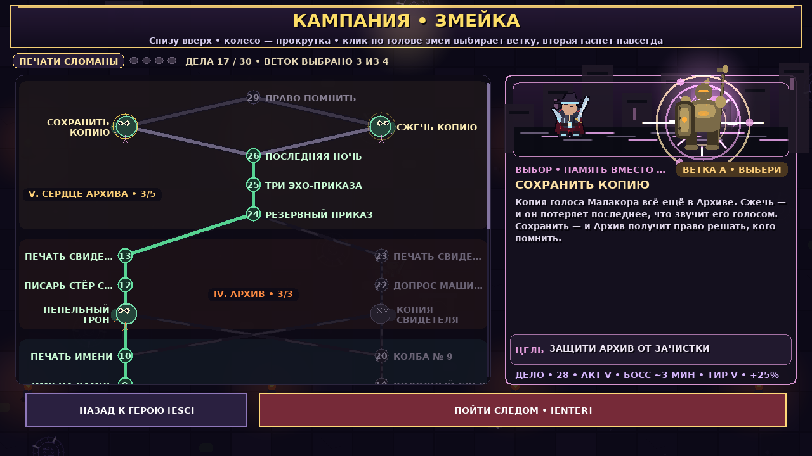
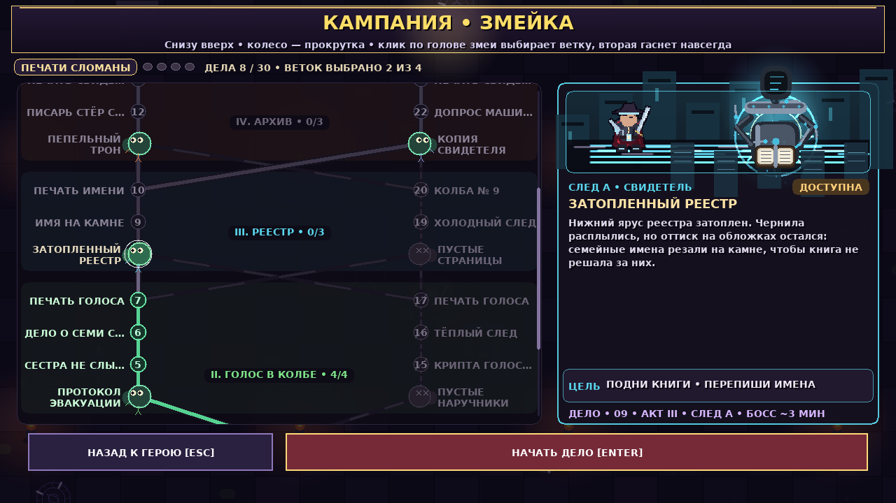
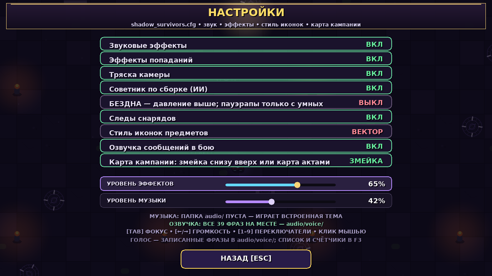
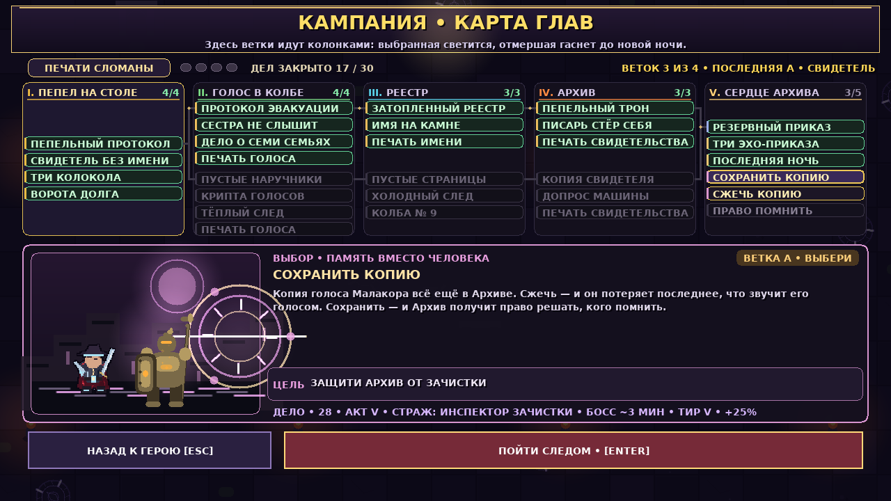
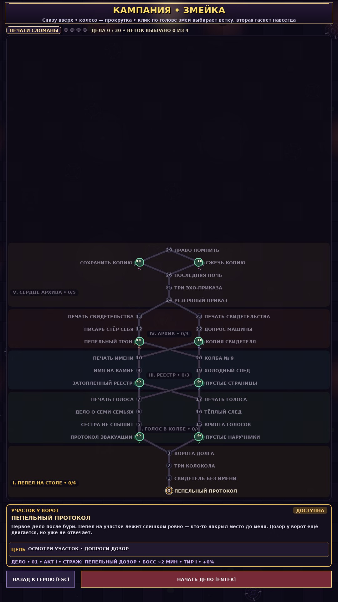

# Кампания: развилка в каждом акте и карта-змейка (2.10.34)

Задача была из двух частей и обе про одно: **выбор должен быть виден**.

1. Выбор в кампании был один — вход в акт II. Дальше игрок механически шёл
   выбранным следом, а до выбора в акте V доходил, не заметив, что он вообще был:
   два дела подряд в одной колонке читаются как ещё две ступеньки, а не как выбор.
2. Прежний экран кампании — это карта актами, колонки слева направо: игрок читает
   её как документ. Нужен маршрут снизу вверх, с настоящими развилками и
   отмирающими ветками. Старый экран при этом не выбрасывается — на него есть
   переключатель в настройках.

---

## 1. Дерево: четыре развилки вместо одной

Развилка — это два первых дела одного акта, которые выросли из одного места.
Выбор одной головы навсегда гасит вторую.

| Развилка | Акт | Верхняя голова | Нижняя голова |
|----------|-----|----------------|---------------|
| 1 | II | 04 ПРОТОКОЛ ЭВАКУАЦИИ (след А) | 15 ПУСТЫЕ НАРУЧНИКИ (след Б) |
| 2 | III | 09 ЗАТОПЛЕННЫЙ РЕЕСТР | 19 ДЕЛО О ПУСТЫХ СТРАНИЦАХ |
| 3 | IV | 12 ПЕПЕЛЬНЫЙ ТРОН | 22 КОПИЯ СВИДЕТЕЛЯ |
| 4 | V | 28 СОХРАНИТЬ КОПИЮ | 29 СЖЕЧЬ КОПИЮ |

Чтобы развилки стояли в каждом акте, головы акта III должны открываться из **любой**
полосы акта II: сначала слияние, потом новая развилка. Поэтому у дел 009, 011, 019 и
022 по два пререквизита (`prereqA` / `prereqB`), и достаточно любого из них. Это
единственное изменение в данных: остальные 26 строк таблицы не тронуты.

Проверка дерева живёт в генераторе:

```
python3 tools/campaign.py check
  прохождение по следу 1: 19 дел
  прохождение по следу 2: 19 дел
```

`check` теперь сверяет и развилки: обе головы одной развилки висят на одном узле,
открываются с обеих полос прошлого акта и стоят в том же акте. Генератор печатает
`CAMPAIGN_MISSIONS[]` байт в байт — расхождений с `src/game.h` ноль (поле `mapTitle`
раньше правилось руками, теперь тоже в скрипте).

## 2. Сейв v9

```c
uint32_t saveVersion = 9;      // было 8
uint8_t  campaignFork[4];      // 0 — не выбрано, 1 — А, 2 — Б
```

Миграция v8 → v9: прежний `campaignTrack` (один след на всю кампанию) переносится в
развилки II–IV, а выбор акта V восстанавливается по тому, какое из двух дел было
закрыто. Прогресс не теряется: если в старом сейве был выбран след Б и закрыты дела
до конца акта IV, после миграции открытым остаётся ровно выбор в акте V.

Загрузка по-прежнему размеро-терпимая: `got < sizeof(SaveData)` включает миграцию,
поэтому старый файл без хвоста читается и обновляется на месте.

## 3. Экран «ЗМЕЙКА»



- **Снизу вверх.** Акт I у нижней кромки, акт V у верхней. Камера при входе стоит
  внизу — там, где игрок сейчас находится, — и сама подъезжает к делу, выбранному
  с клавиатуры.
- **Ряд считается из дерева, а не из таблицы:** дело стоит на ряд выше своего
  пререквизита. Поэтому обе головы развилки автоматически оказываются на одном ряду,
  а финальное дело — над выбором. Всего 19 рядов.
- **Пройденное зелёное, непройденное серое.** Зелёным светится и ребро, и узел,
  только когда пройдены оба конца.
- **Развилка = две головы змеи.** Голова — два круга (череп и челюсть), глаза со
  зрачком и раздвоенный язык. У отмершей головы вместо глаз крестики.
- **Отмершая ветка гаснет вся:** узлы перечёркнуты, ребра рвутся на штрихи, подпись
  тускнеет. Это необратимо до новой ночи.
- **Клик по голове выбирает ветку.** Первый клик показывает дело в досье, второй (или
  Enter) идёт в бой — случайно развилку не перещёлкнуть.
- **Колесо мыши** прокручивает маршрут; справа полоса с положением камеры.
- **Счётчики актов считают одно прохождение:** в акте с развилкой в счёт идёт одна
  голова, поэтому «3/6» в акте V больше не появится.



## 4. Переключатель



Девятая строка настроек — `options.campaignSnakeMap`: **ЗМЕЙКА** или **КАРТА**.
Старый экран целиком сохранён:



В старом экране переход на новую модель тоже виден: колонка акта V показывает
«3/5», обе головы финала подсвечены, а в досье стоит метка «ВЕТКА А • ВЫБЕРИ».
В портретном окне змейка работает как вертикальный маршрут:



Широкое окно (≥1040 px и шире, чем выше) — карта и досье рядом; узкое — змейка сверху,
досье снизу, кнопки двумя рядами.

## 5. Что нашлось по ходу

- `campaignSnakeLevel` сначала считал ряд из слота полосы. Акт V — одна полоса из
  шести дел, поэтому он получал 20 рядов вместо 19, а две головы финала вставали
  друг над другом вместо одного ряда. Ряд теперь выводится только из пререквизитов.
- `confirmCampaignSelection` фиксировал выбор через старое поле `campaignTrack`, а у
  выбора в акте V это поле равно 0. Финальный выбор не записывался вообще. Теперь
  фиксируется `chooseCampaignFork(mission)` — через ту же функцию, что и запуск.
- Подписи актов наезжали на названия последних дел полосы: между актами не было
  зазора под заголовок. Появился `actHeaderPad` (20 px в ландшафте), и подпись стоит
  в этом зазоре.
- `setClip` действовал только на текст: прокручиваемая карта рисовала маршрут поверх
  кнопок внизу. Отсечение перенесено на уровень `blendPixel`/`blendSpan`, поэтому
  теперь режет и заливки, и линии, и круги.
- В шапке главного меню висело «28 ДЕЛ» из старого линейного дерева. Теперь там
  считается за ночь: **19 ДЕЛ**.

## 6. Замеры

Стенд `/tmp/st/shot.cpp` собирает `Game` вне окна, ставит `STATE_MISSION_SELECT`,
кладёт маску пройденных дел и сохраняет кадр (PPM → PNG). Прогоны: свежий сейв,
середина кампании, открытая развилка акта V, старый стиль, 1920x1080, 1600x900,
1280x720, 800x600, портрет 1080x1920.

Стенд `/tmp/st/logic.cpp` проверяет правила без картинок:

```
act1 done:          forks 0 0 0 0 | open=1
chose B:            forks 2 0 0 0 | 4 locked=1, 14 доступна
act3 heads         8 unlocked=1, 18 unlocked=1   (обе головы открыты с любой полосы)
chose save-copy:    forks 2 0 2 1 | 28 locked=1, 29 unlocked после 27
```

Стоимость кадра (меню, 200 кадров подряд, `-O2`): змейка **11,08 мс**, прежняя карта
**9,68 мс** из 16,7. Разница 1,4 мс — это 19 рядов узлов, 30 рёбер с толстой
подложкой и пять полос актов. Бюджет меню не боевой, но запас оставлен.

## 7. Ограничения

- Клавиатурная навигация в змейке идёт по прежней сетке «акт × полоса»: стрелки
  водят курсор по делам, а не по рёбрам маршрута. Для мыши ограничений нет.
- Перетаскивание карты мышью не сделано: камера едет колесом и подъезжает к
  выбранному делу.
- Слияние за пределами акта V (когда обе головы ведут в разные акты) графом не
  поддерживается — и не нужно: в текущем дереве слияние всегда на входе в акт.
